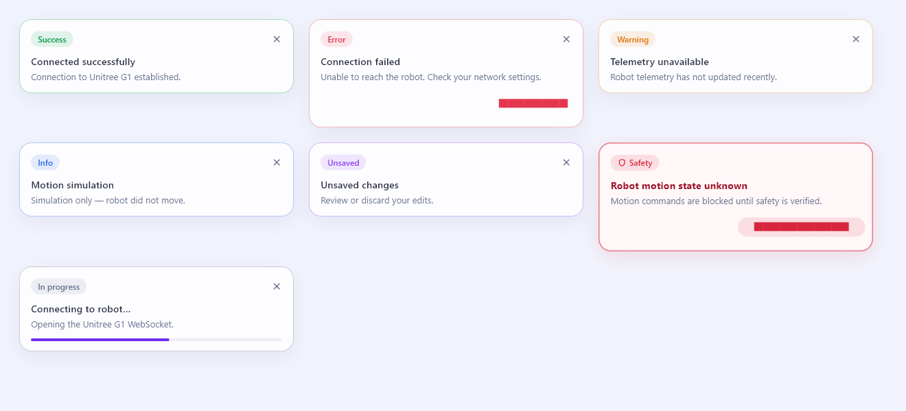
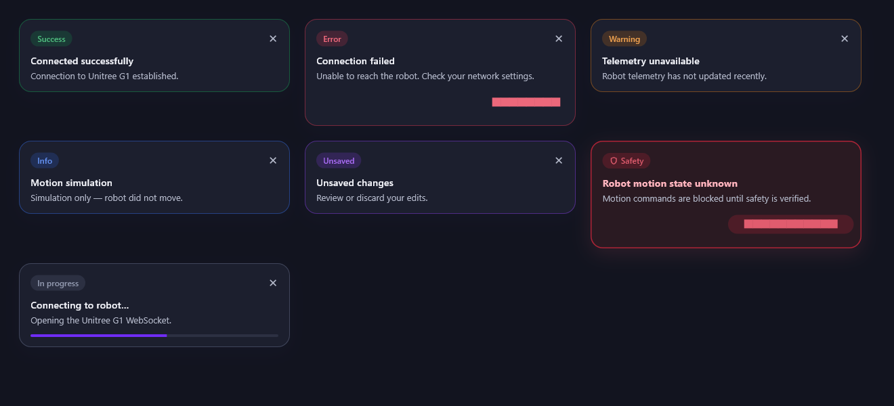
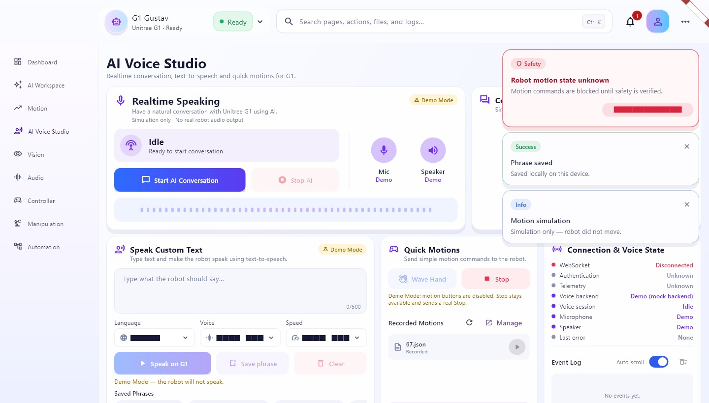

# Notifications

PilsLab Control shows feedback as floating notification cards instead of
Flutter's default black SnackBars. One overlay host is mounted above every
route. It never shifts page layout, and the same API is used everywhere.

| Light | Dark |
|---|---|
|  |  |

In the app (desktop, top-right, below the header):



> These previews come from Flutter's test renderer. It draws Material button
> and dropdown labels as solid bars, and its shadows are approximations.
> The running app shows normal text and soft shadows.

## Usage

```dart
// Inside a Riverpod consumer
ref.read(appNotificationsProvider.notifier).success(
  'Connected successfully',
  description: 'Connection to Unitree G1 established.',
);

// From any widget with a BuildContext
context.notifications.warning('Telemetry unavailable');
```

| Method | Badge | Auto-dismiss |
|---|---|---|
| `success` | Success | 3.5 s |
| `info` | Info | 4.5 s |
| `warning` | Warning | 7 s |
| `error` | Error | 12 s (pass `persistent: true` to `show` to keep it) |
| `unsaved` | Unsaved | 6 s |
| `critical` | Safety | never; only **Acknowledge** or `resolve(key)` removes it |
| `progress` | In progress | never; update or dismiss it |

All methods accept an optional `key`, `description` and `action`
(`AppNotificationAction('Settings', onPressed)`). `show()` is the general form
and also takes `badge`, `icon`, `duration` and a `progress` value.

- **Update in place:** show again with the same `key`, for example
  `progress('Connecting…', key: 'robot-link')` followed by
  `success('Connected', key: 'robot-link')`.
- **De-duplication:** identical events without a key share one card and only
  restart its timer.
- **Stacking:** at most 3 cards are visible. More are queued and promoted as
  cards close. A critical card always takes a visible slot.
- **Dismissal:** `dismiss(key)`, or `dismissAll()`, which never removes
  critical cards.
- **Timers:** countdowns run only while a host is mounted. They pause while
  a card is hovered or focused, and stop when the host is disposed.

## Behavior and accessibility

- Enter is a 220 ms fade, slide and size animation. Exit takes 180 ms and
  happens in place. Both are disabled when the platform asks for reduced
  motion.
- Desktop: cards are top-right, 400 px wide, below the 88 px header. Compact
  (< 600 px): full width with 12 px margins, below the header, respecting
  SafeArea. Cards stay at the top, so they never collide with the keyboard or
  the bottom navigation bar. Margins are configurable through
  `AppNotificationPlacement`.
- Each card is a semantics live region announced once as
  "badge. title. description". The close button has a tooltip.
- **F6** moves keyboard focus into the notification stack and back. Tab moves
  between buttons, Enter activates, and Esc dismisses the focused card.
  Focus returns to where it was when the last card closes.

## Safety rules

- A critical card is never timed out, never cleared by `dismissAll`, has no ✕
  button, and is never resolved automatically by a Stop result. A `dry_run`
  "stopped" reply looks the same, so only the user's acknowledgement removes
  it.
- Notifications only *present* state. They never send robot commands, change
  the motion safety lock, or change authentication.
- Persistent state stays inline next to what it describes: the link status in
  the header and the Settings connection panel, credential messages under the
  token field, settings sync status in Settings, and voice status in AI Voice
  Studio. Toasts never replace confirmation dialogs or forms.
- While the robot is unreachable, the dashboard retries forever. The
  connection notification reports each outage once and stays quiet through
  the retry cycle until the link connects again.

## Where it is used

| Source | Notification |
|---|---|
| Robot link (`RobotLinkNotifications`) | Connecting / reconnecting / waiting for telemetry (progress) → Connected (success). Telemetry stale (warning). Connection failed (error, Settings action). Authentication required (persistent error, Settings action). |
| Motion page and AI Voice Studio Quick Motions (`notifyMotionCommand`) | Sending/Stopping (progress), Motion simulation (info), completed/stopped (success), busy/unavailable (warning), failed (error), **Robot motion state unknown (critical)** |
| Motion page helpers | Selection, saved recording, import/export results |
| Dashboard | Quick-action and selection feedback, "not available yet" |
| AI Voice Studio | Conversation start/end/error, speaker busy, voice disconnected, TTS simulating/finished/not played, Demo Mode on/off, transcript copied, phrase saved/updated/deleted/rejected |
| Settings | Settings saved / unsaved / reduces protection / restart required. Token saved, removed or failed (the inline messages stay). |

## Files

```
lib/shared/notifications/
  app_notification.dart            types, model, actions
  app_notification_service.dart    AppNotificationService + appNotificationsProvider
  app_notification_card.dart       AppNotificationCard + AppNotificationTone
  app_notification_host.dart       AppNotificationHost (overlay, animation, F6)
  robot_link_notifications.dart    link → notification policy
lib/features/motion/presentation/motion_notifications.dart
```

Tests: `test/notifications/` (service, policy, motion mapping, card variants
in light and dark, overflow, placement, stacking and queue, timeouts and hover
pause, actions, keyboard, semantics, critical persistence, reduced motion,
navigation without leaks, and a guard that no `SnackBar` returns to `lib/`).
